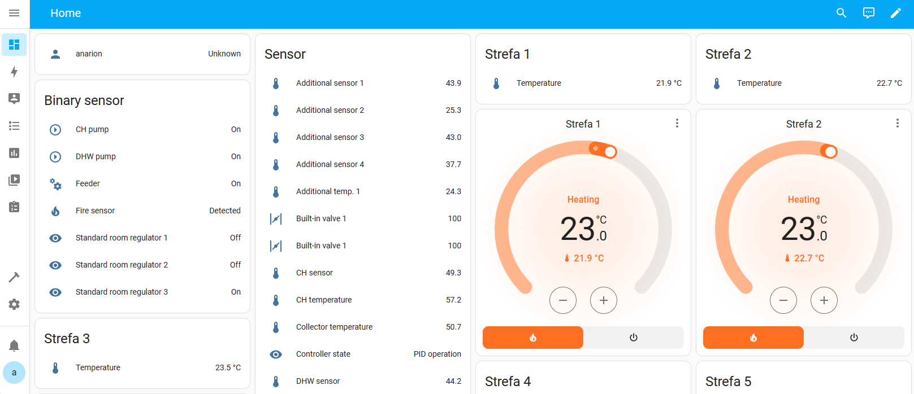
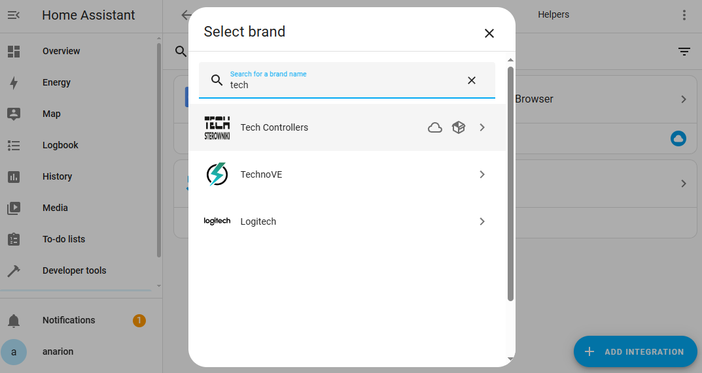
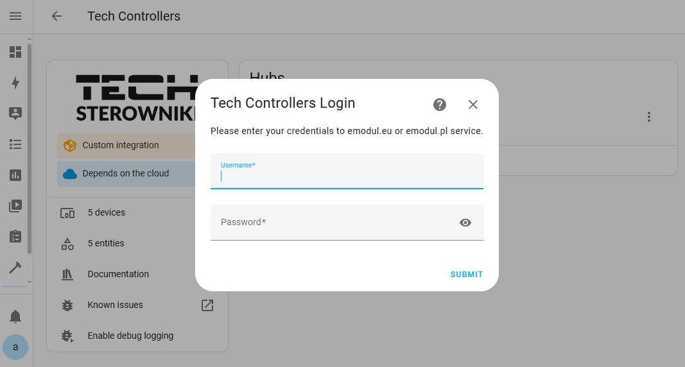
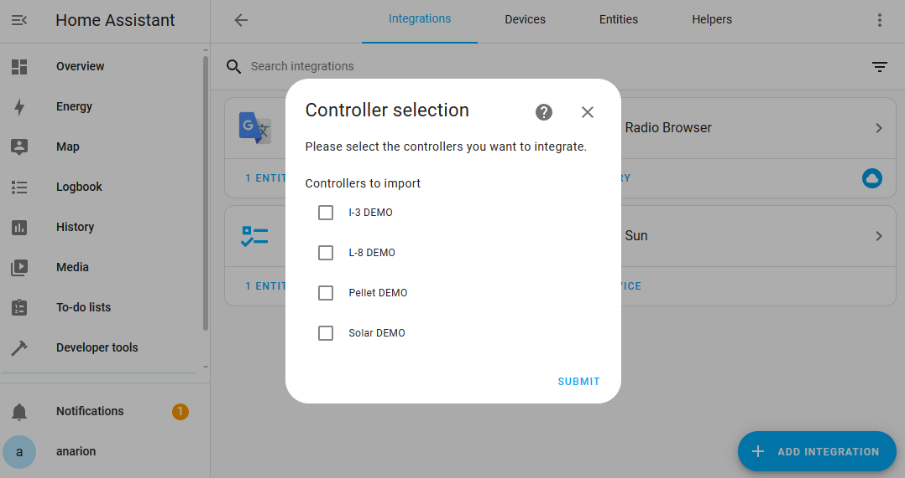
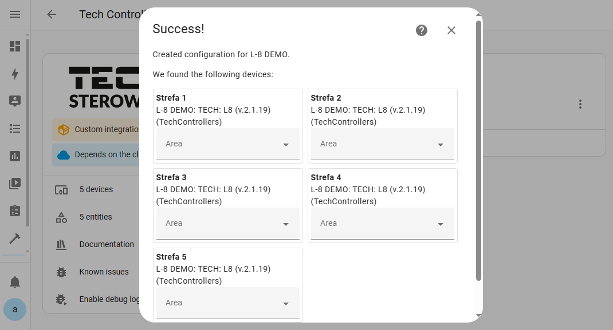
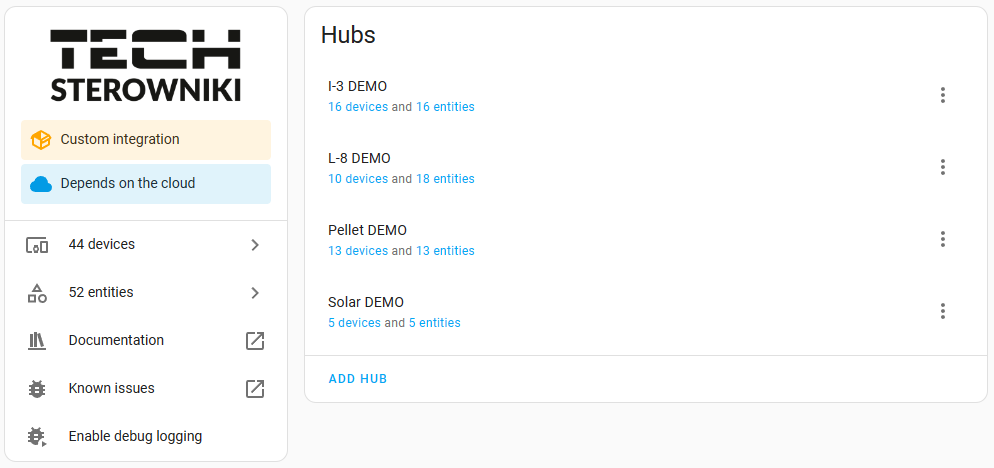

# :jigsaw: TECH Controllers integration for Home Assistant

[![GitHub Release][releases-shield]][releases]
[![GitHub Activity][commits-shield]][commits]
[![License][license-shield]](LICENSE)

[![Project Maintenance][maintenance-shield]][maintainer]

This is an integration of heating controllers from Polish company [TECH Sterowniki Sp. z o.o.](https://techsterowniki.pl/). It uses [API](https://api-documentation.emodul.eu/) to their web control application eModul.eu, therefore your controller needs to be accessible from the Internet and you need an account either on <https://emodul.eu> or <https://emodul.pl>.

The integration is based on API provided by TECH which supports the [list of compatible controllers](https://github.com/mariusz-ostoja-swierczynski/tech-controllers?tab=readme-ov-file#rocket-list-of-reported-working-tech-controllers)

The integration was developed and tested against eModul demo account (username: `test`/password: `test`) which features 4 controllers:

- I-3
- L-8
- Pellet
- Solar

and community reported controllers.

> [!WARNING]
> Everything else might or might not work - needs community help, testing and reporting back what works. Check below for reported working controllers.

## :sparkles: Features

- Configuration through UI
- Support for multiple controllers which can be individually imported under given single account
- Provides Climate entities representing zones
  - and their corresponding Temperature, Battery, Humidity sensors, Window sensors when available
- Climate entities display data through Thermostat card
- Limited support for Menu handling (thanks [lhruska](https://github.com/lhruska)!)
- Provides sensors for eModul 'tiles'
- Automatic naming and translations of tiles from eModul API
- Supporting languages which are supported by eModul API

**This integration will set up the following platforms.**

| Platform        | Description                         |
| --------------- | ----------------------------------- |
| `binary_sensor` | Show info and status from Tech API. |
| `sensor`        | Show info and status from Tech API. |
| `climate`       | Thermostats.                        |
| `button`        | Button for dialogue menu items.     |
| `switch`        | Switch for menu parameters.         |
| `number`        | Number for menu parameters.         |
| `select`        | Select for menu parameters.         |



Anything the eModul app offers beyond the platforms listed above is not exposed here: what the integration provides is what its entities provide.

## :building_construction: Installation

### Prerequisites

- An account on <https://emodul.eu> or <https://emodul.pl> with the controller already added to it.
- The controller reachable from the Internet: the integration talks to the eModul cloud service, not to the controller directly.
- A Home Assistant version this release supports. HACS warns when your version is older than the one declared in [`hacs.json`](./hacs.json).

### Parameters

The setup form asks for:

- **Username** — the account name (or email address) you use on <https://emodul.eu> or <https://emodul.pl>.
- **Password** — the password for that account.
- **Controller to import** — the controller to add, chosen from the ones the account holds. One controller is added per run of the flow, so repeat it for the next one.
- **Include hub (controller) name in entity names** — the naming preference described under Configuration below, so it can be answered while the controller is being added.

### HACS

[](https://my.home-assistant.io/redirect/hacs_repository/?owner=mariusz-ostoja-swierczynski&repository=tech-controllers&category=integration)

### Manual

1. Using the tool of choice open the directory (folder) for your HA configuration (where you find `configuration.yaml`).
1. Download `tech.zip` asset from [latest release](https://github.com/mariusz-ostoja-swierczynski/tech-controllers/releases/latest)
1. Unzip into `custom_components/` directory (folder), if directory doesnt exist, create it.
1. Restart Home Assistant
1. In the HA UI go to `Settings` -> `Devices & services` click `+` and search for `Tech Controllers`
   
1. Enter your username (could be email) and password for your eModule account and click "Submit" button.
   
1. In the next step select the controllers you want to import/integrate
   
1. You should see "Success!" dialog with the name of the imported controller(s).
   

1. Now you should have controllers and entities representing your home zones available in Home Assistant. Go to your UI Lovelace configuration and add Thermostat card with your Climate entities.
   

## :gear: Configuration

Each controller entry has one option, reached through the gear button on the entry in `Settings` -> `Devices & services`:

- **Include hub (controller) name in entity names** — prefixes the entity names of the controller's zones with the name of the integration, so a zone reads `L-8 DEMO Strefa 1` instead of `Strefa 1`. Useful when several controllers are set up and their zone names would otherwise be identical; leave it off when only one controller is configured.

The same preference is asked during setup, it belongs to one controller entry at a time, and changing it afterwards reloads the entry so the renamed entities follow immediately.

## :wastebasket: Removal

1. In Home Assistant go to `Settings` -> `Devices & services`, open `Tech Controllers` and use the three-dot menu of each controller entry to delete it. Deleting an entry removes the devices and entities that belong to that controller.
1. Remove the integration itself:
   - HACS: open HACS, find `Tech Controllers` among the installed integrations and remove it there.
   - Manual installation: delete the `custom_components/tech` directory (folder) from your Home Assistant configuration directory.
1. Restart Home Assistant.

## :rocket: List of reported working TECH Controllers

- L-7 (v.2.0.8)
- L-7E (v.1.0.6)
- L-8 (v.3.0.14)
- L-9r (v1.0.2)
- L-12 (v.1.0.16)
- L4-WiFi (v.1.0.24)
- L-X WiFi (v1.0.6)
- M-9 (v1.0.12)
- M-9r (v1.3.8)
- ST-8s WIFI (v.1.0.5)
- ST-16s WIFI (v.1.0.5)
- ST-491 (v.2.1.9) -- RS-bridged boiler controllers; CH/DHW/room temperatures, valve, fuel feeder, fan, pumps, disinfection cycle and relays exposed
- ST-505 -- same RS-bridged-boiler family as ST-491; supported via the shared TYPE_WIDGET tile parser
- WiFi 8S (v.2.1.8)

Controllers that are not on this list may well work: the eModul module API is the same one, and the controller only has to appear in the account. One that does not work is worth an issue with the controller's JSON attached, which is what the list is built from.

## :arrows_counterclockwise: How the data updates

Home Assistant polls the eModul service every 60 seconds, one request per controller, and never the other way around: eModul offers no push, so a change shows up here at the next poll.

- A poll that fails marks that controller's entities unavailable, and one that succeeds makes them available again; the entry says it is retrying until then.
- A write -- a thermostat, a menu switch, a number, a select or a dialogue button -- is sent to the API and shown straight away. eModul reports the previous value for a short window while it applies the change, so the integration leaves the optimistic value in place and lets the next poll reconcile it.
- A tile, a zone or a menu item the controller starts reporting becomes an entity on the next poll. One it stops reporting for an hour is removed, together with the device that held it.

## :bulb: Examples

A night setback for the zones of a controller:

```yaml
automation:
  - alias: "Tech: night setback"
    triggers:
      - trigger: time
        at: "22:30:00"
    actions:
      - action: climate.set_temperature
        target:
          entity_id: climate.l_8_demo_strefa_1
        data:
          temperature: 18
```

A reminder when a wireless sensor's battery runs low:

```yaml
automation:
  - alias: "Tech: low battery"
    triggers:
      - trigger: numeric_state
        entity_id: sensor.l_8_demo_zone_battery
        below: 20
    actions:
      - action: notify.persistent_notification
        data:
          title: "Sensor battery"
          message: "{{ trigger.to_state.name }} is at {{ trigger.to_state.state }}%"
```

## :no_entry: Known limitations

- eModul is a cloud service. The integration talks to it and not to the controller, so the controller has to be online in the eModul app and this Home Assistant needs an internet connection.
- Data arrives by polling every 60 seconds, so a state can lag up to a minute behind the app.
- One account at a time, and only the controllers that account holds; each controller is added as its own entry.
- Tile names, menu labels and the icon a tile carries come from eModul's own data, in the language the account is set to.
- Menu items are read when their platform sets up, so one added in the app appears after Home Assistant reloads that entry.
- History is eModul's and Home Assistant's; this integration does not backfill it.

## :wrench: Troubleshooting

- Every entity of a controller is unavailable: the service could not be reached, or the controller is offline. Check the controller in the eModul app and the entry's state under `Settings` -> `Devices & services`.
- The entry says "Authentication expired": the account's token is no longer accepted. Authenticate again from the entry's menu; the controller and its entities are kept.
- The entry says "Failed, retrying setup: the eModul API cannot be reached": the service or the connection is down. Home Assistant retries by itself, and nothing has to be done.
- A controller is missing from the list while setting up: the account has to hold it, and the credentials you enter are the ones whose controllers are listed.
- Anything else: download the entry's diagnostics from its menu and attach them to an issue. They describe the controller and never carry the account's token.

## :house_with_garden: Use cases

- Heat with the thermostats: schedules, setbacks and away automations drive the zones like any other climate entity.
- Watch the boiler: the sensors follow the tiles eModul reports, so a pump, a valve or a fan can be put on a dashboard and alerted on.
- React to alarms: window sensors, the zone state and the controller's own status tiles are entities an automation can act on.

## :pray: Thanks

Version 2 of the integration is based on work from several contributors and/or forks of the original integration:

- [MichalKrasowski](https://github.com/MichalKrasowski)
- [micles123](https://github.com/micles123)
- [nedyarrd](https://github.com/nedyarrd)
- [anarion80](https://github.com/anarion80)
- others

## :warning: Disclaimer

The integration is in no way supported or endorsed by TECH Sterowniki sp. z o.o.

## 📝 Copyright & License

Copyright (c) 2026, Released under the [MIT](LICENSE) license.

---

[commits-shield]: https://img.shields.io/github/commit-activity/y/custom-components/blueprint.svg?style=for-the-badge
[commits]: https://github.com/mariusz-ostoja-swierczynski/tech-controllers/commits/main
[license-shield]: https://img.shields.io/github/license/mariusz-ostoja-swierczynski/tech-controllers?style=for-the-badge
[maintenance-shield]: https://img.shields.io/badge/current%20maintainer-anarion80-blue.svg?style=for-the-badge
[maintainer]: https://github.com/anarion80
[releases-shield]: https://img.shields.io/github/release/mariusz-ostoja-swierczynski/tech-controllers.svg?style=for-the-badge
[releases]: https://github.com/mariusz-ostoja-swierczynski/tech-controllers/releases
